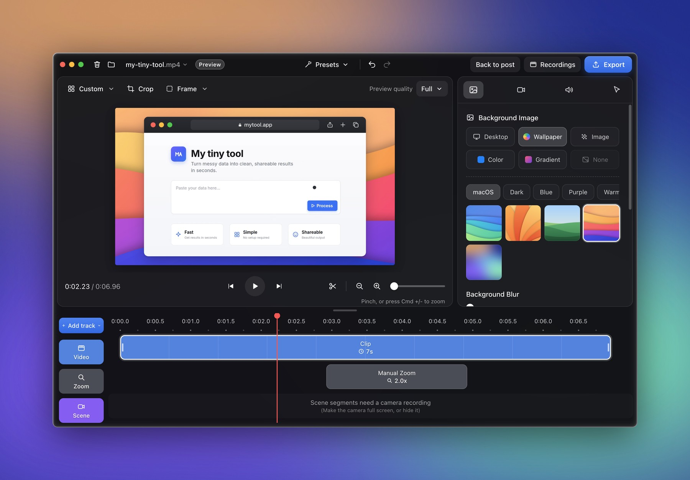
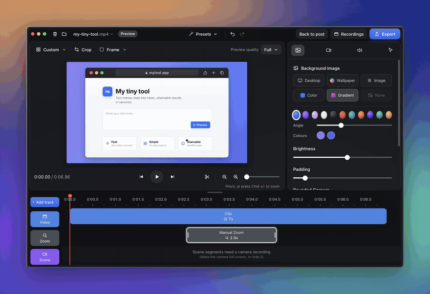
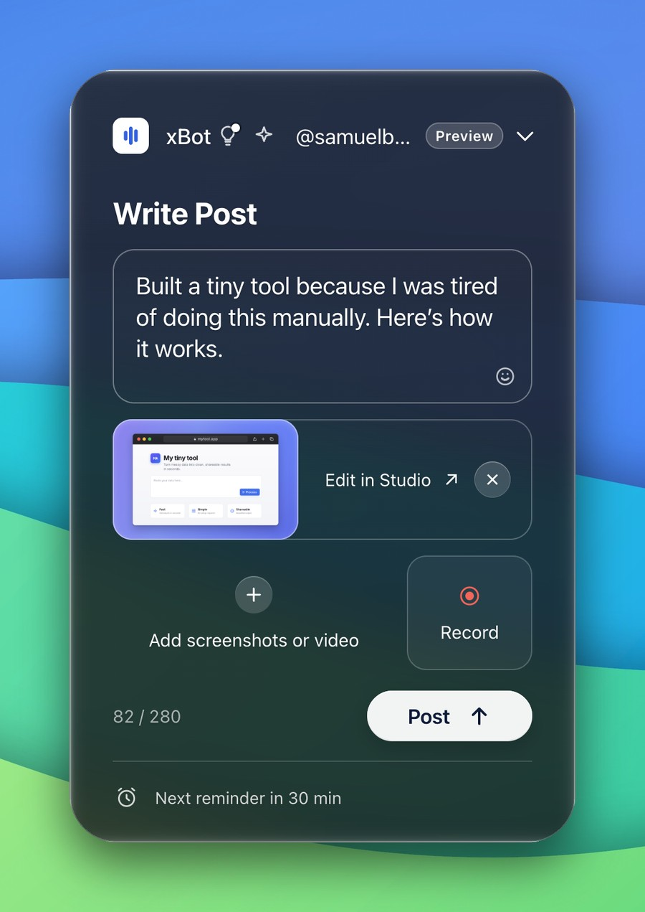
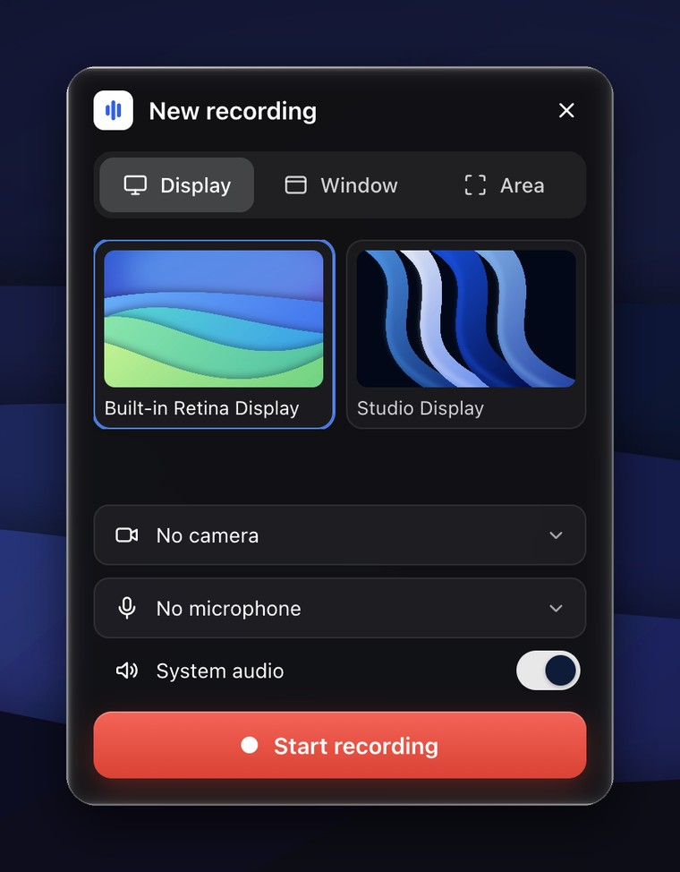
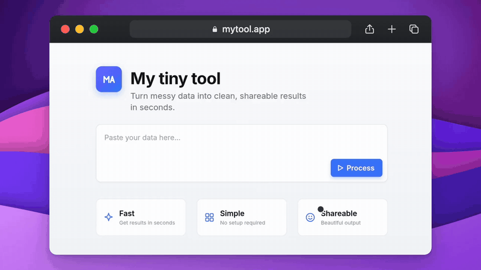
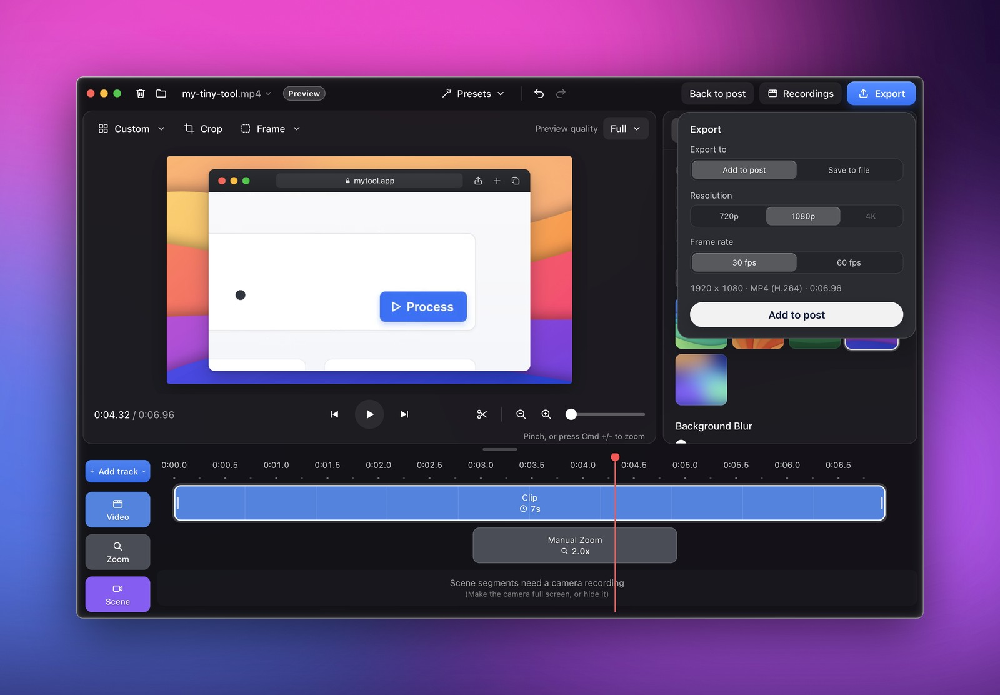

# xBot

**Turn the small tools you build every day into authentic posts on X — from your menu bar.**

<p align="center">
  
</p>

xBot is a macOS menu-bar app. Click its icon and a compact **Write Post**
dropdown opens: write, drop in a screenshot or a video, or **record your
screen**, polish it in **Media Studio**, and post it to X with your own
developer app, or copy it and post it yourself.

- **Screen recording and a Cap-style editor.** Record a display, a window or an
  area, with your camera and microphone. The Studio puts it on a wallpaper,
  redraws the cursor smoothly with click ripples, zooms in where you clicked,
  and exports MP4 up to 4K, encoded on your Mac.
- **AI runs only on your Mac**, through [Ollama](https://ollama.com). There is
  no hosted fallback and no API key. It suggests posts, rewrites them, and finds
  story ideas in the project folders you approve.
- **Publishing uses the official X API** and your own X developer app. Nothing
  is posted without your click.
- **Reminders** nudge you every 30 minutes during working hours, and can open
  the dropdown without stealing focus.

## See it

<p align="center">
  
  <br><sub>Pick a wallpaper, press play: the zoom eases in on the button and back out. (<a href="docs/media/studio-demo.mp4">MP4</a>)</sub>
</p>

<table>
  <tr>
    <td align="center" width="50%"><br><sub><b>Write Post</b>: draft, attach, record, post.</sub></td>
    <td align="center" width="50%"><br><sub><b>New recording</b>: a display, a window or an area, with camera and mic.</sub></td>
  </tr>
</table>

<p align="center">
  
  <br><sub>What the Studio exports: 1080p H.264, ready for X. (<a href="docs/media/export-demo.mp4">MP4</a>)</sub>
</p>

<p align="center">
  
</p>

Everything works without Ollama, without FFmpeg (it's only needed to read
videos), without an X account and without a network connection. Each of those
only adds a feature, and xBot says plainly when one is missing (see
[Works offline](#what-works-offline)).

The product brief is [`docs/SPEC.md`](docs/SPEC.md). The code's conventions
are in [`docs/ARCHITECTURE.md`](docs/ARCHITECTURE.md).

## Requirements

- **macOS** on Apple Silicon or Intel. xBot was developed against macOS 15.
- **To build it:** Node.js 22.12 or later and pnpm 11.28.6. The version is
  pinned in `package.json`, so `corepack enable pnpm` gives you the right one.
  The Xcode Command Line Tools (`xcode-select --install`) build the clear
  glass and screen recorder; without them xBot still builds and runs (see [Native addons](#native-addons)).
- **Optional:**
  - [Ollama](https://ollama.com/download), for local AI;
  - FFmpeg (`brew install ffmpeg`), for video;
  - an [X developer app](https://console.x.com), to post from xBot.

## Commands

```sh
pnpm install          # dependencies and Electron (the lockfile is committed)
pnpm dev              # run it with hot reload; data goes to "xBot Dev"
pnpm build            # build main, preload and renderer into out/
pnpm test             # unit tests (Vitest)
pnpm package          # dist/: a .dmg and a .zip for Apple Silicon and for Intel
```

> **Electron:** `pnpm install` also downloads Electron's app binary, or takes
> it from Electron's download cache. If that step fails (offline, for
> example), `pnpm install` fails with a note, and `pnpm dev` stops with
> "Electron uninstall": run `pnpm exec install-electron` once you're back
> online. `ELECTRON_SKIP_BINARY_DOWNLOAD=1 pnpm install` skips the download.

| Command | What it does |
|---|---|
| `pnpm test:e2e` | Builds, then runs the Playwright tests against the real app (`tests/e2e/`). The video tests need FFmpeg. |
| `pnpm typecheck` | `tsc` for main, preload, renderer and scripts. |
| `pnpm lint` | ESLint, including the main/preload/renderer boundary rules. |
| `pnpm preview:ui` | Builds, then opens [preview mode](#preview-mode) on a fresh sample userData. |
| `pnpm capture` | Builds, then captures both windows and compares them with the reference image (`docs/reference/captures/`). Needs FFmpeg. On a Mac, `pnpm capture --desktop` also takes real screenshots over four wallpapers; it needs Screen Recording permission for the terminal. |
| `pnpm capture:glass` | macOS: builds, then takes real screenshots of both windows over on-screen backdrops at Glass clarity 0, 80% and 100%, and checks text contrast and the glass's opacity (`test-results/glass/`). Needs Screen Recording permission for the terminal and an unlocked screen; your wallpaper is not changed. |
| `pnpm native` | Rebuilds the native addons, glass and screen capture (`dev`, `build`, `package` and `pnpm install` do it when needed). |
| `pnpm fixtures` | Builds, then re-renders preview mode's sample media in `resources/fixtures/`. Needs FFmpeg with libx264. |
| `pnpm icons` | Re-renders the tray PNGs and `build/icon.png` from the SVGs in `resources/`. |

Environment switches, all honoured only in unpackaged runs:
- `XBOT_REQUIRE_FFMPEG=1` turns "FFmpeg not found, skipping" into a test failure.
- `XBOT_VIBRANCY=hud|popover|under-window|fullscreen-ui|none` tries another
  native material.
- `XBOT_USER_DATA_DIR=<dir>` puts the data in `<dir>`.
- `XBOT_GLASS=off` skips the native glass addon: today's system glass, as
  without the Command Line Tools.

**On Linux** (CI only; xBot targets macOS):
- run `pnpm dev --noSandbox`, because Ubuntu's AppArmor blocks Chromium's
  sandbox for an unpackaged Electron;
- run the e2e tests and `pnpm capture` under `xvfb-run -a`;
- `pnpm package` makes a `.zip` only.

## Installing the unsigned app

`pnpm package` makes an **unsigned** app with an ad-hoc signature (Apple
Silicon refuses to run completely unsigned code). Open the `.dmg` for your Mac
(`arm64` for Apple Silicon) and drag **xBot** to **Applications**. xBot
lives in the menu bar: it has no Dock icon and no window until you click it.

macOS Gatekeeper only stops an app that was *downloaded*. One you built
yourself opens directly. For a downloaded copy:
- open it once, then use **System Settings → Privacy & Security → Open
  Anyway** (on macOS 14 and earlier, right-click → **Open** also works); or
- run `xattr -dr com.apple.quarantine /Applications/xBot.app`.

Signing with a Developer ID and notarization are optional and not set up. To
add them, set `mac.identity`, `hardenedRuntime: true` and `notarize` in
`electron-builder.yml` (comments there). Two features behave better in a signed
build:
- **Notifications:** macOS may not show them for an ad-hoc signed app. xBot
  notices when one doesn't appear, and says so in the reminder row when
  reminders depend on notifications.
- **Launch at login** is offered only for the packaged app in
  `/Applications`.

## Native addons

Two small native addons (built together by `scripts/build-native.mjs`): the
glass, below, and the screen recorder (`native/capture/`, ScreenCaptureKit; see
"Screen recording").

On macOS xBot's windows are clear liquid glass with 40 px corners. A small
native addon (`native/glass/`, public AppKit API only) fades macOS's frosted
material and rounds it. **Settings → Appearance → Glass clarity** sets how
clear it is: 80% by default, 0% for macOS's own frosted look. Text keeps a
soft shadow and the cards behind text get darker as the glass clears, so it
stays readable over light and busy backgrounds. Glass clarity is off while
Reduce transparency is on.

`pnpm install` builds the addon with the Xcode Command Line Tools
(`xcode-select --install`). Without them it prints one line and xBot runs with
the system's glass: frosted, with small corners, and the slider disabled.
Without them screen recording is unavailable too. `pnpm package` refuses to
package without the addons. After installing the tools, run `pnpm native`.

## Local AI with Ollama

1. Install Ollama from <https://ollama.com/download> and open it. It listens
   on `http://127.0.0.1:11434`.
2. In xBot, follow onboarding, or open **Settings → Local AI**:
   - pick an installed model; or
   - download one of the suggestions: `gemma3:4b` is recommended, and
     `llama3.2:3b`, `gemma3:1b` and `gemma3:12b` are offered by memory size.
     A download starts only when you click **Download**.
3. **Local-only mode (recommended).** xBot refuses cloud models on its own. You
   can also turn Ollama's cloud features off: add
   `{"disable_ollama_cloud": true}` to `~/.ollama/server.json`, or run
   `launchctl setenv OLLAMA_NO_CLOUD 1`, then quit and reopen Ollama. xBot
   never changes Ollama's configuration for you.

Only loopback endpoints are accepted (`127.0.0.1`, `localhost`, `[::1]`).
Local AI costs no per-request fee, but it uses your Mac's memory, compute,
storage and power, and small models write weaker drafts.

**Troubleshooting:**

| You see | Do |
|---|---|
| Ollama not running | Open Ollama (or install it), then **Check again**. |
| Model needed | Choose an installed model or download a suggested one. |
| "runs in the cloud" | That model is a cloud model; choose a local one. |
| "took too long" | Try again, pick a smaller model, or turn on low-resource mode. |

The full verified API notes, limits and troubleshooting are in
[`docs/OLLAMA.md`](docs/OLLAMA.md).

## Posting to X

xBot posts through the official X API with **your own X developer app**. It
never uses a password or a browser session, and it ships no secret.

1. In the [X Developer Console](https://console.x.com), create a Project and an
   App. In **User authentication settings**, turn on **OAuth 2.0** with:
   - **Type of App:** Native App (a public client: PKCE, no Client Secret);
   - **App permissions:** Read and write;
   - **Callback URI:** `http://127.0.0.1:47813/callback`, exactly. If you
     change the port in **Settings → X**, register the URL shown there instead.
2. Copy the app's **OAuth 2.0 Client ID** (from **Keys and tokens**) into
   **Settings → X → Client ID**.
3. Click **Connect X account** and approve in your browser. xBot asks for
   `tweet.read tweet.write users.read media.write offline.access`. The header
   then shows your real handle.

**Billing:** X API access is pay-per-use, billed to *your* X developer account
by X, separately from xBot's free local AI. Set a spending limit in the
console. Without an account, **Post ↑** offers the manual path: **Copy text**,
**Export media** and **Open X**.

Tokens are encrypted with macOS's `safeStorage` (Keychain) and never stored as
plain text. Setup details, prices checked on 2026-10-22, limits and
troubleshooting are in [`docs/X.md`](docs/X.md).

## FFmpeg for video

```sh
brew install ffmpeg
```

Then press **Check again** in Media Studio. xBot looks in this order:
1. a program you picked with **Locate FFmpeg…**;
2. `/opt/homebrew/bin`;
3. `/usr/local/bin`;
4. your `PATH`.

It needs FFmpeg 4.4 or later with an H.264 encoder, `aac` and `ffprobe`.
Without FFmpeg, images still edit and export, and videos still attach to
posts. Only video editing and MP4 export wait for it.

**Licensing:** xBot does **not** bundle FFmpeg. The ready-made Mac builds are
GPL (they include x264), so v1 runs the FFmpeg you installed as a separate
program, which puts no obligations on xBot. The checked licence facts and what
an LGPL bundle would need are in [`docs/FFMPEG.md`](docs/FFMPEG.md).

## Screen recording

Click **Record** in Write Post (or **Start Recording…** in the menu bar's
right-click menu). Pick a display, a window or an area, a camera, a microphone
and whether to record system audio, then **Start recording**: a 3-2-1
countdown, then a stop bar with Stop, Pause, Restart and Delete. The recording
opens in the Media Studio, Cap-style: on a wallpaper, with automatic zooms
where you clicked, the cursor redrawn (smooth, with click ripples), the camera
as a bubble, and the microphone and system sound at separate volumes.
**Recordings** in the Studio lists them all.

macOS asks once for **Screen Recording**, **Camera** and **Microphone**
access (while developing, the app is listed as "Electron"). After allowing
Screen Recording, quit and reopen xBot. Recording needs macOS 13, a microphone
macOS 15. A recording is limited to 1 GB, X's video limit (about ten minutes
of a full Retina screen).

## Where your data lives

| Run | Folder |
|---|---|
| The packaged app | `~/Library/Application Support/xBot` |
| `pnpm dev`, the tests, any unpackaged run | `~/Library/Application Support/xBot Dev` |
| `--preview` or `XBOT_PREVIEW=1` | `~/Library/Application Support/xBot Preview` |
| `pnpm preview:ui` | a temporary folder, removed when it quits |

Inside each one:
- `xbot.db`: SQLite (drafts, Studio documents, presets, ideas, voice,
  reminders, X accounts and publish jobs, settings);
- `media/`: imported files and Studio exports, with `media/thumbs/`;
- `recordings/`: one folder per screen recording (camera video, cursor data,
  audio tracks);
- `logs/main.log`: a plain local log, never sent anywhere;
- `tmp/`: emptied at every start.

Nothing is written into the repository or next to the app.

## Backup and restore

**Back up:** **Settings → Data → Back up data…**, then choose a folder. xBot
writes `xBot Backup <date> <time>` with:
- `xbot.db`: a consistent copy, taken in one go even while xBot is writing;
- `media/`: every file the database refers to;
- `manifest.json`: tables, row counts and files;
- `RESTORE.txt`.

X sign-in tokens are left out: they only decrypt on the Mac that made them.
A backup that fails, or is stopped by quitting, removes its half-written
folder.

**Restore** (also in `RESTORE.txt`):
1. Quit xBot: right-click the menu-bar icon → **Quit xBot**.
2. In `~/Library/Application Support/`, rename `xBot` (for example to
   `xBot before restore`).
3. Make a new `xBot` folder there, and copy the backup's `xbot.db` and `media`
   folder into it.
4. Open xBot. Each X account reads **Reconnect**: sign in again from the
   account menu.

## What works offline

| Works with no network | Needs the network |
|---|---|
| Writing, autosaved drafts and draft history | Downloading an Ollama model (once) |
| Attaching screenshots and video | Connecting an X account |
| Media Studio: every edit, screen recording, PNG/JPEG export, MP4 export (encoded on the Mac) | Posting to X, and **Check X** for an uncertain post |
| Local AI suggestions and rewrites, once a model is installed | **Open X** in the browser |
| Project ideas from approved folders | |
| Reminders, backup, preview mode | |

When something is unavailable, xBot says which and how to fix it instead of
hiding it or faking it. **Settings → Status** lists the chips:
- AI: "Local AI ready", "Ollama not running", "Model needed";
- X: "X not set up", "X disconnected", "Reconnect X";
- video: "FFmpeg not found";
- "Export running".

Offline, X calls fail with "X couldn't be reached. Check your connection." A
post whose outcome is unknown is never re-sent blindly: it waits for a check.

## Preview mode

`pnpm preview:ui` opens xBot with clearly labelled sample data and **no
external publishing**. Every run starts from the same fresh sample. The sample:
- a draft with the reference text and a framed screenshot;
- an older draft with a 12-second sample video;
- one sample idea;
- the sample handle `@samuelbuilds`, always with a **Preview** badge.

The sample is seeded from `resources/fixtures/` through xBot's own import and
Studio code, so drafts, history, attaching, Media Studio and video export all
really work.

Off in preview mode:
- local AI;
- X: it never touches the network, and **Post ↑** only offers "post it
  yourself";
- project folders;
- reminders and onboarding.

`--preview` (packaged: `open -n -a xBot --args --preview`) or `XBOT_PREVIEW=1`
keeps a persistent `xBot Preview` folder instead. It runs beside your normal
xBot without touching its data.

## Privacy

- **No telemetry, no analytics, no accounts** for xBot itself.
- **Nothing leaves your Mac**, except:
  - the Ollama model downloads you start;
  - the X API calls you make by connecting and posting;
  - links you open in your browser.
- **Project files:**
  - xBot reads only the folders you approve;
  - it respects `.gitignore` and `.xbotignore`, and never reads secrets,
    `.env` files, keys, dumps, dependencies or build output;
  - it redacts tokens before anything reaches the local model;
  - it never runs repository code.
- **Never recorded:** the screen, keystrokes or browser history. xBot writes
  to the clipboard only when you click **Copy text**, and never reads it.

## License

xBot is open source under the [MIT License](LICENSE). FFmpeg is not part of it: xBot runs the copy you install (see "FFmpeg for video").
